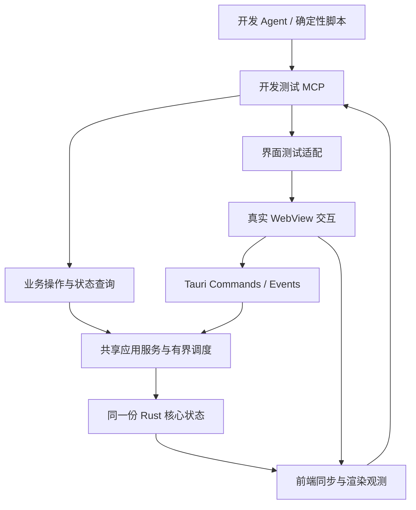

# 开发测试 MCP

## 目标与适用范围

在 LayerLens 测试实例内提供显式启用的 MCP，供开发 Agent 探索、定位故障，并供确定性脚本重复执行跨层回归。目标是逐步覆盖应用的全部已实现功能，包括业务操作、界面交互和状态观测；覆盖范围随功能交付维护，不为尚未实现的局部参考图、导出或产品工具提供假成功入口。

本文件是待实施的设计，具体 SDK、驱动、工具名称、Schema 及运行命令在工程验证后确定。当前实现和优先顺序见[开发记录](../devlog/README.md)，首个工程任务为 [DEV-01](../devlog/_plan/261013/DEV-01-开发测试MCP与M2自动验收.md)。

开发测试 MCP 提供可操作、可等待、可观测的入口，测试预期由样本和验收规范独立给出。保留已有 Rust 单元／集成测试与 Vitest 测试；跨层回归只覆盖需要真实实例、状态同步或文件行为的场景。M2 的系统窗口、文件选择器、跨屏 DPI 等验收继续保留，不能因增加测试协议而自动归档。

## 与产品 MCP 的关系

| 维度     | 产品 MCP                                   | 开发测试 MCP                                       |
| -------- | ------------------------------------------ | -------------------------------------------------- |
| 使用者   | 在 H5 项目中消费设计数据的 Agent           | 开发 Agent、测试脚本与 CI                          |
| 对象     | 用户打开的文档或已有任务                   | 专门启动的测试实例、受控样本和输出目录             |
| 能力     | 发现文档、绑定范围、读取上下文、预览与素材 | 业务操作、界面驱动、同步等待及测试观测             |
| 选区控制 | 遵循用户授权的快照与任务范围               | 可显式建立测试选区，仍经过实际版本校验与提交规则   |
| 发布     | 按产品连接设置启用                         | 编译特性与运行开关共同启用，普通发行包不含开发工具 |

产品契约仍由[MCP 与 Agent 协作](05-MCP与Agent协作.md)维护。开发工具不扩大产品 MCP 的文件与操作权限；未来可共用传输、Schema 生成和业务服务，但工具注册、凭据与运行配置分别管理。产品连接不能通过参数切换到开发权限。两类入口均遵守 PSD 只读、固定范围、取消、资源预算和结果发布规则。

## 架构与复用边界

- 复用同一测试实例的核心、文档注册表和后台调度。业务工具调用应用服务或已有桌面操作入口，不另建解析会话，不直接改写注册表、任务状态或 Vue 响应式值。
- 当前入口位于 `src-tauri/src/commands.rs` 与 `workspace/`。先识别 Commands 中需要共同保留的校验、准入、错误映射与发布复检，再抽取被两种适配层调用的最小共享入口；不要绕过这些边界直接调用底层解析方法。
- 核心不依赖 MCP 消息、Tauri Commands、WebDriver 或测试客户端类型。开发工具与驱动由适配层管理；仅因实际复用需要调整模块，不提前拆出通用自动化框架。
- 业务调用可以跳过点击和文件选择器，但只能计为业务路径测试。菜单、拖动、键盘、焦点等用例必须经过真实前端事件路径，不能用直接提交最终选区替代拖动过程。
- 界面驱动优先验证现成 WebDriver／WebView 自动化方案与当前锁定 Tauri、Windows WebView2 的兼容性。MCP 统一提供操作入口，驱动是否内嵌、是否需要独立测试进程由小型原型决定；未验证前不声明原生输入或截图能力已可用。
- 必要的前端测试桥只暴露类型化操作与观测，不开放任意 JavaScript、Shell、任意 IPC 调用或组件内部状态修改。DOM 合成事件与真实驱动输入须分别标记证据类型。

## 能力覆盖清单

以下为能力分组，不是已经发布的工具名称；实现时由单一类型来源生成 Schema，并维护功能、入口、场景和验证层级的对应关系。

| 分组       | 操作与观测                                             | 对应验收                               |
| ---------- | ------------------------------------------------------ | -------------------------------------- |
| 实例       | 查询构建、协议、会话、实际能力和配置摘要；结束测试实例 | 不误连日常实例，退出释放后台及监听     |
| 文档       | 打开受控样本、切换、关闭、重载、取消加载               | 多文档隔离、修订、失败恢复、队列准入   |
| 图层与内容 | 图层分页、属性、原文与分段样式                         | 样本预期、UTF-16 区间、分页与回复预算  |
| 选区与任务 | 图层选择、矩形提交、清空、固定／列举／读取／释放任务   | 授权、版本、快照不变性、幂等与乱序     |
| 预览       | 获取已实现的合成预览；M3 再接固定范围参考图            | 图像像素、尺寸、来源、缓存及取消       |
| 清理       | 预检、确认、取消与读取终态                             | 影响变化、失效、其他文档隔离、晚到发布 |
| 界面       | 语义定位、点击、按键、拖动、面板切换、界面状态与截图   | 菜单、草稿、吸附、焦点、模态和视图同步 |
| 资源与诊断 | 等待指定状态、读取账本及相关操作事件                   | 超时定位、最后引用释放、后台退出       |
| 导出（M3） | 发起、查询、取消，读取终态清单与受控产物               | 文件完整性、路径、偏移、取消及结果恢复 |

“全部功能覆盖”通过清单持续维护：业务入口覆盖不等于界面入口覆盖；受限、缺少样本和未执行的项明确标记。新增功能交付时同步新增相应场景与证据，不以工具数量代替覆盖程度。

## 协议、状态与等待

### 工具契约

- 每项工具声明输入、输出及副作用；外部参数运行时校验，Rust 类型／Schema 与客户端契约保持一致。MCP 初始化、工具枚举和 JSON-RPC 错误维持标准协议结构，只注册当前实例实际支持的工具。
- 工具业务结果沿用 `structuredContent` 中的 `data` 与 `userSelection`，并提供对应 JSON 文本内容。测试结果和观测信息放在 `data` 中；`userSelection` 仍携带原子取得的已提交选区及区域内容，按同一快照续页，不读取草稿。完整封装、文本和图像均纳入各自预算。
- 操作携带实例／会话身份及适用的文档修订、选择版本、请求 ID。复用既有冲突与幂等规则；未知响应只按原请求恢复，不能重新生成 ID 并盲目重试副作用。
- 图像、长文字、任务和事件按需读取并有界分页；诊断默认只返回关联 ID、阶段、耗时、计数和错误，不广播完整原稿、源路径或凭据。显式请求的设计内容沿用范围与预算约束。

### 分层观测

一次操作应区分以下证据，某层证据缺失时不能将该层标为通过：

| 层级 | 需要观测的状态                                                 | 能证明的行为                                       |
| ---- | -------------------------------------------------------------- | -------------------------------------------------- |
| 核心 | 会话、状态序号、文档修订、快照／任务、作业阶段                 | 操作是否已被核心接受及提交                         |
| 前端 | 前端实例代次、已应用的核心序号、展示目标、草稿／弹窗／焦点状态 | 真实前端是否应用对应状态，目标是否一致             |
| 显示 | 与目标修订关联的图像解码、绘制准备状态、驱动截图               | 显示准备与被采集画面；不自动证明物理首帧或其他 DPI |

前端序号由实际通知处理路径推进，不能由 MCP 写入“已同步”。纯视图操作使用独立视图代次，不伪造核心版本。大整数序号沿用可无损的线协议表示。跨层采样携带各自版本，不能把分时读取包装成同一原子快照；截图应能关联捕获时的目标与状态。

### 有界等待与错误恢复

等待条件采用预定义类型，例如核心序号达到目标、指定任务进入终态、前端应用目标状态或指定图像就绪；不执行客户端传入的任意表达式。优先按事件唤醒，使用单调时钟截止时间，限制等待者数量和保留事件大小，不靠固定休眠或无限重试判断完成。

等待返回满足条件的实际观测；超时附最后状态、关联请求和未满足条件。事件记录被截断、前端断连、实例退出或会话更换时明确报告，不拼接不同会话的证据。取消等待只终止观测，不隐式取消已接受的业务作业；业务取消仍调用对应入口。等待不能占住执行取消或清理所需的工作线程、状态锁或唯一操作队列。

## 开发实例与资源边界

- 使用独立的 `dev-mcp` 编译特性和显式运行开关；名称为本方案约定，当前尚无对应构建入口。未编入特性时不注册开发工具或监听器，编入但未启用时也不自动监听。普通发行构建与开发测试构建分别验证，包含 release 模式的测试构建仍须显式开启。
- 首选桌面进程内的回环 Streamable HTTP 服务，使用每次实例生成的凭据并校验适用的 Host／Origin。端口可配置或分配，连接信息报告实际地址，不硬编码个人路径、端口或令牌；凭据不进入日志和仓库。
- 回归脚本启动独立测试实例，隔离界面持久化配置、会话、临时目录和输出；核对实例标识后再操作或退出，不复用或重启用户的日常工作实例。
- 文件打开限定配置的样本根目录，输出限定本次运行目录；校验规范路径、符号链接／目录联接和已有文件冲突。PSD 始终只读，不能通过开发模式取得任意文件修改权限。关闭或清理也不删除源 PSD。
- 保持当前源数据、解码、缓存和作业预算；测试观测、图像传输、等待者、事件记录另设有界准入，明确所有者与释放时机。不得为通过测试默认提额或启用无限后台。
- MCP 连接断开释放订阅、等待者和未执行的连接级界面请求，不擅自改变已接受业务作业的生命周期。实例退出停止准入、取消相应工作、释放测试桥和监听，并走应用既有的核心关闭路径；启动失败同样回收部分资源。

## 回归证据与职责

测试预期来自已核对样本、独立像素／文字数据和[实施与验收](06-实施与验收.md)。MCP 返回事实与诊断，脚本作出断言；不把接口返回的 `success`、同一实现重新计算出的值或自动更新快照作为正确性的唯一证据。

开发 Agent 可通过 MCP 探索异常并复现最小场景；稳定流程固化为无需模型判断的测试脚本，CI 与本地使用同一入口。报告记录提交、构建模式、系统／WebView／驱动版本、样本指纹、配置、操作序列、期望和实际值、关联 ID、失败阶段及适用截图／产物。效率收益通过重复运行的耗时、稳定性和故障定位结果评价，不预先宣称已经提速。

| 验证层级          | 适用范围                                       | 保留的限制                                     |
| ----------------- | ---------------------------------------------- | ---------------------------------------------- |
| 核心与组件回归    | 纯规则、边界、确定性并发及组件事件             | 不替代真实进程、IPC 或原生焦点                 |
| 开发 MCP 业务场景 | 实际实例、共享状态、资源与文件行为             | 跳过的菜单、拖动和选择器不算覆盖               |
| 真实 WebView 场景 | 实际输入、前端事件、IPC、通知和显示            | DOM 合成事件不能冒充原生输入；截图不代表全平台 |
| 原生专项验收      | 系统窗口、文件选择器、跨屏 DPI、贴靠和正常退出 | 按实际环境逐项记录，未执行项继续待验收         |

故障注入仅在已有回归无法稳定控制关键顺序时引入，限定命名检查点和测试构建，不修改生产判断结果；第一批不建立通用故障注入框架。

## 分批实施与出口

| 批次          | 交付目标                                         | 验收出口                                                                                     |
| ------------- | ------------------------------------------------ | -------------------------------------------------------------------------------------------- |
| DEV-01 第一批 | 内嵌传输、实例边界、现有业务入口、状态与有界等待 | 真正的 MCP 客户端连接同一桌面实例，完成文档—选区—任务—清理闭环及负向回归；普通构建无开发入口 |
| DEV-01 第二批 | 驱动兼容验证、界面操作、前端同步与显示观测       | 菜单、任务面板、清理弹窗及选区草稿／取消经真实 WebView 验证，保留系统专项缺口                |
| DEV-01 第三批 | 确定性脚本、报告与 Windows CI                    | 可重复运行并定位失败，本地／CI 同入口，测试实例退出无残留资源；M2 场景证据回填原任务         |

第一批最小闭环：打开 A、B → 在 A 提交范围并固定任务 → 改选并切换 B → 关闭 A → 读取旧任务的原修订内容 → 清理旧 A → 核对任务失效与 B 隔离。扩展用例覆盖重载、同路径重开、预检取消／过期／影响变化、请求重试、迟到结果、源文件哈希和最后引用计费；复用现有回归的预期，按层记录新增证据。

开发基础设施达到上述出口后，M3 依次推进固定快照局部参考图、受控 PNG 导出作业与桌面闭环，每批将相应能力加入本清单。M4 产品 MCP 可复用已验证基础设施，但仍独立完成产品工具、权限和真实 H5 模块验收。DEV-01 完成不自动代表 M2、M3 或 M4 完成。

## 实现前待验证项

- 官方 Rust SDK 候选 `rmcp` 的版本、许可证、传输与取消语义、Schema／图像输出及选定客户端互通。采用锁定版本，并先评估已有依赖能力。
- Windows WebView 驱动与锁定 Tauri 的兼容性、输入与截图证据范围、测试桥通信方式、并发和退出行为；原型失败时保留结果并明确降级，不将浏览器模拟环境写为原生通过。
- 前端应用序号、视图代次和截图关联的实现位置，以及等待条件与回复／事件预算；避免观测通道改变业务提交顺序或长期持有 PSD 修订。
- CI 中真实桌面运行所需环境及限制、开发特性关闭检查、测试实例隔离和产物保留策略；只有实际运行后才宣称该层自动验收可用。
