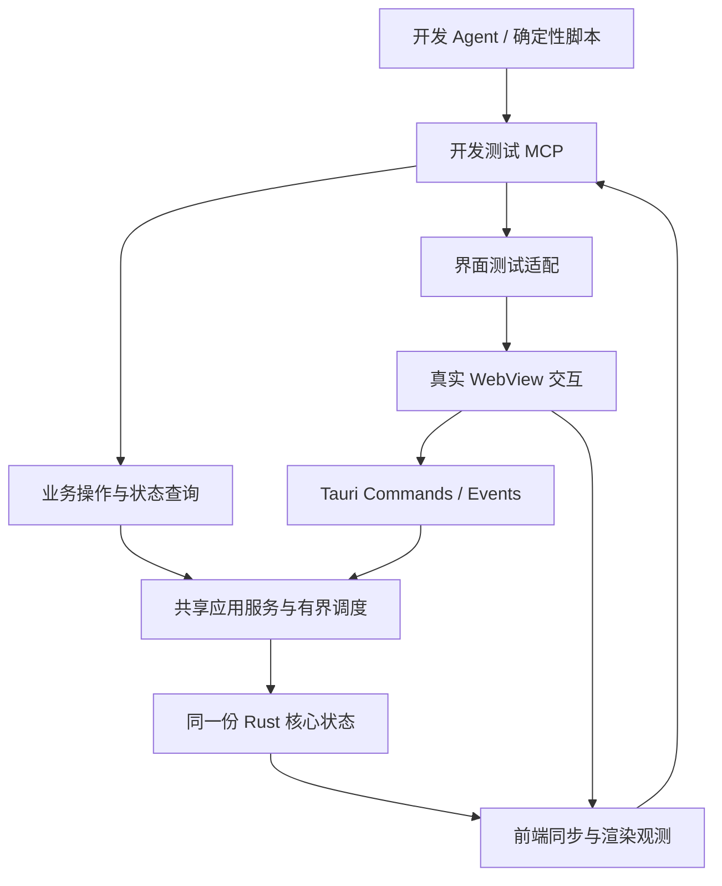

# 开发测试 MCP

## 目标与适用范围

在 LayerLens 测试实例内提供显式启用的 MCP，供开发 Agent 探索、定位故障，并供确定性脚本重复执行跨层回归。目标是逐步覆盖应用的全部已实现功能，包括业务操作、界面交互和状态观测；覆盖范围随功能交付维护，不为尚未实现的局部参考图、导出或产品工具提供假成功入口。

本文件维护设计与已实现边界。DEV-01 第一批已实现[业务入口与有界等待](#当前实现dev-01-第一批)，第二批已接入[真实 WebView 输入与前端观测](#当前实现dev-01-第二批)，第三批已配置[Windows CI、稳定性与产物保留](#当前实现dev-01-第三批)。本机重复回归已有证据；远端运行暴露的阻塞及修复验证统一记录在 [DEV-01](../devlog/_fin/261014/DEV-01-开发测试MCP与M2自动验收.md)，当前优先顺序见[开发记录](../devlog/README.md)，运行命令见[项目 README](../README.md#开发测试-mcp)。

开发测试 MCP 提供可操作、可等待、可观测的入口，测试预期由样本和验收规范独立给出。Agent 功能测试的必需入口及能力不足时的补齐顺序遵循[仓库测试约定](../AGENTS.md#测试与持续集成)，原生专项的测试入口扩展同样遵循该流程。保留已有 Rust 单元／集成测试与 Vitest 测试；跨层回归只覆盖需要真实实例、状态同步或文件行为的场景。M2 的系统窗口、文件选择器、跨屏 DPI 等验收继续保留，不能因增加测试协议而自动归档。

## 与产品 MCP 的关系

| 维度     | 产品 MCP                                   | 开发测试 MCP                                       |
| -------- | ------------------------------------------ | -------------------------------------------------- |
| 使用者   | 在 H5 项目中消费设计数据的 Agent           | 开发 Agent、测试脚本与 CI                          |
| 对象     | 用户打开的文档或已有任务                   | 专门启动的测试实例、受控样本和输出目录             |
| 能力     | 发现文档、绑定范围、读取上下文、预览与素材 | 业务操作、界面驱动、同步等待及测试观测             |
| 选区控制 | 遵循用户授权的快照与任务范围               | 可显式建立测试选区，仍经过实际版本校验与提交规则   |
| 发布     | 按产品连接设置启用                         | 编译特性与运行开关共同启用，普通发行包不含开发工具 |

产品契约仍由[MCP 与 Agent 协作](05-MCP与Agent协作.md)维护。开发工具不扩大产品 MCP 的文件与操作权限；未来可共用传输、Schema 生成和业务服务，但工具注册、凭据与运行配置分别管理。产品连接不能通过参数切换到开发权限。两类入口均遵守 PSD 只读、固定范围、取消、资源预算和结果发布规则。

## 架构与复用边界

- 复用同一测试实例的核心、文档注册表和后台调度。业务工具调用应用服务或已有桌面操作入口，不另建解析会话，不直接改写注册表、任务状态或 Vue 响应式值。
- 当前入口位于 `src-tauri/src/commands.rs` 与 `workspace/`。先识别 Commands 中需要共同保留的校验、准入、错误映射与发布复检，再抽取被两种适配层调用的最小共享入口；不要绕过这些边界直接调用底层解析方法。
- 核心不依赖 MCP 消息、Tauri Commands、WebDriver 或测试客户端类型。开发工具与驱动由适配层管理；仅因实际复用需要调整模块，不提前拆出通用自动化框架。
- 业务调用可以跳过点击和文件选择器，但只能计为业务路径测试。菜单、拖动、键盘、焦点等用例必须经过真实前端事件路径，不能用直接提交最终选区替代拖动过程。
- 界面驱动使用独立的 Microsoft Edge WebDriver 进程，以 `browserName: webview2` 启动隔离的 Tauri 测试实例。MCP 内的受限客户端绑定该实例的驱动会话，统一提供操作入口；驱动部署由回归脚本负责。本机版本已验证，其他版本与环境须重新验证。
- 必要的前端测试桥只暴露类型化操作与观测，不开放任意 JavaScript、Shell、任意 IPC 调用或组件内部状态修改。DOM 合成事件与真实驱动输入须分别标记证据类型。

## 能力覆盖清单

Konva 验证的专属实例、语义输入、真实绘制观测及证据要求见[渲染器设计](09-渲染器对比实验.md#mcp-与证据)。工具扩展应先于对应功能回归；历史证据见 RENDER-01／02，选型后的能力保留、清理与真实回归结果见 [RENDER-03](../devlog/_fin/261017/RENDER-03-选型实验清理与Konva验证收敛.md)。

以下为能力分组，不是已经发布的工具名称；实现时由单一类型来源生成 Schema，并维护功能、入口、场景和验证层级的对应关系。

| 分组       | 操作与观测                                             | 对应验收                               |
| ---------- | ------------------------------------------------------ | -------------------------------------- |
| 实例       | 查询构建、协议、会话、实际能力和配置摘要；结束测试实例 | 不误连日常实例，退出释放后台及监听     |
| 文档       | 打开受控样本、切换、关闭、重载、取消加载               | 多文档隔离、修订、失败恢复、队列准入   |
| 图层与内容 | 图层分页、属性、原文与分段样式                         | 样本预期、UTF-16 区间、分页与回复预算  |
| 选区与任务 | 图层选择、矩形提交、清空、固定／列举／读取／释放任务   | 授权、版本、快照不变性、幂等与乱序     |
| 预览       | 获取已实现的合成预览；M3 再接固定范围参考图            | 图像像素、尺寸、来源、缓存及取消       |
| 清理       | 预检、确认、取消与读取终态                             | 影响变化、失效、其他文档隔离、晚到发布 |
| 界面       | 语义定位、点击、按键、拖动、面板切换、界面状态与截图   | 菜单、草稿、吸附、焦点、模态和视图同步 |
| 资源与诊断 | 等待指定状态、读取账本及相关操作事件                   | 超时定位、最后引用释放、后台退出       |
| 导出（M3） | 发起、查询、取消，读取终态清单与受控产物               | 文件完整性、路径、偏移、取消及结果恢复 |

“全部功能覆盖”通过清单持续维护：业务入口覆盖不等于界面入口覆盖；受限、缺少样本和未执行的项明确标记。新增功能交付时同步新增相应场景与证据，不以工具数量代替覆盖程度。

## 当前实现：DEV-01 第一批

`src-tauri/src/dev_mcp/` 在 `dev-mcp` 编译特性下提供内嵌回环 Streamable HTTP，显式传入 `--dev-mcp-config <JSON 路径>` 后启用。锁定 `rmcp 3.5.0`，当前协商协议为 `2025-11-25`，使用无持久传输会话的 JSON 响应；业务身份仍为独立的 `instanceId` 与核心 `sessionId`。不提供通用 Shell、JavaScript 或任意 IPC 执行。

| 工具            | 已接入能力                                                 | 变更与读取规则                                           |
| --------------- | ---------------------------------------------------------- | -------------------------------------------------------- |
| `dev_instance`  | 版本、实例／会话、实际工具、预算、活动等待数               | 首次以空对象调用                                         |
| `dev_workspace` | 快照、打开、激活、关闭、重载、取消作业、检查单选、提示清除 | 复用 `WorkspaceRequest`；除快照外需请求 ID               |
| `dev_selection` | 图层／区域选择、清空、快照／任务内容、创建／列举／释放任务 | 复用 `SelectionRequest`；内容／列表为读取，其余需请求 ID |
| `dev_cleanup`   | 预检、取消、确认，原请求回执重放                           | 复用 `CleanupRequest`；均需请求 ID                       |
| `dev_layers`    | 当前文档修订的图层分页、详情与文字分页                     | 复用 `LayerRequest` 与原单查询额度                       |
| `dev_preview`   | 已就绪原尺寸合成 PNG 与来源／能力信息                      | 复用 `PreviewRequest` 与原单复制额度，按需返回标准图像块 |
| `dev_wait`      | 序号／清理代次、文档数／修订、预览就绪、无活动作业         | 预定义条件、事件唤醒、超时返回最后状态                   |
| `dev_shutdown`  | 正常停止测试监听并走核心退出                               | 校验实例／会话；退出结果以进程状态为准                   |

除 `dev_instance` 外，输入统一为 `{ instanceId, sessionId, clientRequestId, request }`；读取与退出可省略 `clientRequestId` 或置为 `null`。业务变更必须使用 1–128 个 ASCII 字母、数字或 `-_.:` 构成的请求 ID。相同 ID 与同一工具／参数只执行一次，重复读取原业务回执；不同参数返回 `REQUEST_CONFLICT`。回执仅在本次实例内有效，不能跨重启恢复。打开／重载返回 `accepted` 仅表示已接受，解析是否成功要核对作业、通知和最终文档状态。

Schema 从 Rust DTO 与 `schemars` 生成，核心只增加可选 `schema` 派生，不依赖 MCP 类型；实际 Schema 通过 `tools/list` 读取。工具结果为 `data: { status: "ok", value }` 或 `data: { status: "error", error }`，业务失败设置 `isError=true`；输入形状、实例／会话或协议路由失败保持 JSON-RPC 错误。`userSelection` 携带已提交摘要、区域首批内容及其续页游标；区域内容失败通过 `contentError` 表达，观测整体失败通过 `unavailable` 表达，不抹去已经完成的业务回执。工作区快照和等待结果的附带选择固定到该次状态的摘要；其他操作在响应组装时重新原子取得已提交选区。

当前开发适配的独立上限为：HTTP 请求 128 KiB、工具参数 64 KiB、业务结果 256 KiB、选区封装 128 KiB（区域首批内容 64 KiB）、完整 MCP 回复 2 MiB、PNG 512 KiB；超量内容按既有快照游标续读，超量 PNG 明确拒绝。最多 16 条 HTTP 连接、4 个普通调用、4 个等待者、2 个已接受变更后台；变更回执最多 128 条／8 MiB，在执行前预留，满后拒绝新变更，不淘汰旧回执。等待范围 1–30000 ms，HTTP 请求 35 s 上限、连接 45 s 空闲上限；关闭监听先排空请求，3 s 后强制终止残留传输，再等待已接受变更收尾并关闭核心。上述限制不扩大原有 PSD、解码、缓存与作业额度。

`workspace/access.rs` 抽取 IPC 与 MCP 共用的图像／图层读取；选择、清理及附带内容进入同一有界后台。等待使用仅保留最新状态的 `watch` 通道，不持有 PSD／PNG 租约，也不占工作区执行邮箱。断连结束观测；已经登记的变更继续完成，可按原 ID 查询回执。上述业务工具不证明前端已经同步，须另外使用第二批的前端观测；当前不提供持续事件历史工具。

## 当前实现：DEV-01 第二批

测试配置增加可选 `webDriverUrl`，仅接受带明确非零端口的 `http://127.0.0.1:<port>/` 根地址，不接受认证信息、查询或片段。配置该项才注册以下 6 个驱动工具；加上业务、清理测试和进程采样，共 17 个。所有显式开发实例均注入身份、授予 `main` 窗口 `dev_view_report` 权限并安装只读观测桥，使无驱动的业务测试也能等待前端图像就绪；未配置驱动时保留 11 个工具。普通构建不注册开发命令或权限，启用 feature 但未以测试配置启动也不安装观测桥或启用测试控制。

| 工具                | 已接入能力                                                               | 契约与边界                                                                        |
| ------------------- | ------------------------------------------------------------------------ | --------------------------------------------------------------------------------- |
| `dev_ui_attach`     | 绑定已有 WebDriver 会话，返回运行时和驱动版本                            | 需请求 ID；固定只读探针核对实例及前端代次，禁止改绑其他会话                       |
| `dev_ui_state`      | 读取最新有效前端投影                                                     | 不驱动 UI；未连接或导航中返回 `NOT_FOUND`                                         |
| `dev_ui_action`     | 语义点击、任务名称键入、左键／中键组合手势、画布滚轮、控制键、释放输入   | 需请求 ID 与 `frontendId`；可用 `expectedViewRevision` 拒绝旧布局输入；回执可重放 |
| `dev_ui_wait`       | 等待状态应用、图像准备、面板／菜单、草稿、任务／内容、清理阶段或视图版本 | 1–30000 ms，事件唤醒；超时返回条件及最后状态，指定旧代次时终止等待                |
| `dev_ui_screenshot` | W3C WebDriver WebView PNG 截图                                           | 需 `frontendId`；返回标准 MCP 图像块、尺寸、来源及捕获前后观测                    |
| `dev_ui_capture`    | 固定一次真实截图，按 256×256 物理像素分块读取及释放                      | 需 `frontendId`；同一快照 ID、完整 RGBA 指纹，单块仍受 512 KiB 限制               |

2026-10-17 将分块截图和 `dev_process_metrics` 从渲染实验提升为通用开发测试能力，仍只在隔离开发实例提供。采样仅接受空 `request`，不接受外部 PID，读取本实例与经创建时间／父子关系核验的 WebView 后代；无 Windows 支持时明确失败。分块截图无需 `largeRender`：输入 PNG 最多 8 MiB，RGBA 最多 64 MiB，每驱动只持有一份快照，60 秒失效，替换／释放／退出回收。驱动截图响应最多 12 MiB，其他驱动响应仍为 2 MiB；`dev_ui_screenshot` 及 MCP 图像块的原限额不变。业务回归采样真实进程，普通 WebView 基线回归验证分块读取、指纹拼接和释放。

输入仍使用第一批的实例／会话封装。`inputCompleted` 只表示驱动输入请求完成，随后必须等待对应业务或前端条件。语义目标涵盖菜单命令、工具、面板、文档标签、图层检查／勾选、任务、清理按钮和画布；白名单由 [targets.rs](../src-tauri/src/dev_mcp/ui/targets.rs)维护。不存在的当前界面元素返回驱动错误；工具不接受任意 CSS、XPath、JavaScript 或 IPC。打开文件走受控业务入口，系统文件选择器仍按原生专项验证。

M2 扩展提供 `scroll { x, y, deltaY }` 的真实 W3C wheel 输入：位置以 viewport CSS 像素表示，限定已解码画布，模态或保留拖动时拒绝；`deltaY` 为非零整数且在 -200 至 200 内。复用实际滚轮事件缩放，不直接设置 Vue 状态。任务分页增加 `task:more` 语义目标，仍点击已有“加载更多任务”按钮。M2 套件将各缩放和清理场景分到独立实例，保持原回执及资源预算。

`canvasGesture { steps, hold }` 扩展完整手势，最多 32 步：`move { x, y }`、`down/up { button: "left" | "middle" }` 或 `escape`。第一步必须定位到已解码画布；所有坐标、按钮顺序和最终是否保留按键在派发前一次验证，拒绝越界、模态、重复按下、未按先松及无按键手势。首步瞬移，后续移动各 100 ms；整批通过同一个 W3C 指针源和同步键盘源执行，支持左键草稿中追加中键、不同松键顺序及 Esc 取消。失败后按结果不确定处理，显式取消／释放前拒绝新手势；不开放任意脚本、右键或跨窗口输入。

画布观测补充 CSS 像素平移量 `panX/panY`、实际 `panning`／`pointerCaptured` 及每轴 `snapX/snapY`（文档坐标和图层 ID，画布目标的 ID 为 `null`）。`canvasIdle { pointerEventsAtLeast }` 只在真实指针事件计数达到条件且草稿、平移、捕获均结束时满足，不能以驱动返回成功替代界面终态。旧 `drag` 与 `scroll` 输入保持兼容；开发观测 DTO 增加字段，Rust 与前端须同步重建，不支持混用旧前端。

拖动使用 viewport 的 CSS 像素坐标，起止均限定在已解码图像所在的画布视口内，并拒绝穿过清理模态。一次 Actions 请求发送完整的起点移动、按下、终点移动和松开。`hold=true` 只用于观察未提交草稿、按 Esc 取消，再调用 `releaseInputs` 释放保留输入；普通提交使用 `hold=false`。本机 WebView2／EdgeDriver `154.0.4258.62` 的跨请求分段拖动会丢失指针捕获，未将其包装为可靠能力。输入／截图共用一个执行名额，忙时立即拒绝；拖动失败或保留按下后，其他点击／拖动需先显式恢复。

前端在 Vue 状态与 DOM 更新后上报实际投影：核心序号、会话、活动文档／修订、已提交选区／快照，以及面板、菜单、焦点、草稿、Alt、吸附线、任务和内容状态。`frontendId` 为每次挂载 UUID，`documentEpoch` 与单调递增 `viewRevision` 区分页面代次和本代次变化；导航开始立即使旧观测失效，旧页面迟到报告及乱序报告不能覆盖新状态。观测类型由 Rust [model.rs](../src-tauri/src/dev_mcp/ui/model.rs)生成到 `src/shared/api/devGenerated.ts`，`bindings:dev:check` 检查一致性。

`imageReady` 需要活动文档／修订相符、图像 `decode()` 成功且已经进入下一次 `requestAnimationFrame`。这表明前端准备状态，不是屏幕物理首帧时间。截图的 `unchanged` 仅表示捕获前后前端代次与视图版本相同，不保证所有像素变化均由版本追踪。回归保留关键 PNG 并核对尺寸、状态及画面；不据此宣称其他 DPI、系统窗口或性能已验收。

单份观测不超过 32 KiB，任务与清理任务 ID 各不超过 128 条；前端串行 IPC、慢请求期间只保留最新待发送投影，卸载释放监听与只读桥。只计数 `isTrusted` 指针／键盘事件，最近按键仅保留控制键，不记录任务名键入内容。前端上报失败会在桥中保留错误并使驱动探针失败，不能伪装同步成功。后端仅保留最新观测，等待复用独立的 4 个等待名额，不占驱动执行名额；截图复用 512 KiB PNG／2 MiB MCP 回复上限。W3C HTTP 客户端不使用代理或重定向，每次请求限 12 秒／2 MiB 响应。

## 当前实现：DEV-01 第三批

[Windows 工作流](../.github/workflows/ci.yml)保留原普通构建检查与 NSIS 安装包，并在普通产物上执行开发入口关闭检查；另有独立的 `Windows development MCP` 作业（`windows-2022`），使用锁定 Node／npm／Rust，执行开发特性检查、脚本回归、普通 release 和开发 debug 构建，再运行与本地相同的稳定性入口。两种构建分别启动验证，不能用开发程序代替普通发行关闭检查。新增工作流已通过本地静态检查；实际 GitHub runner 兼容性仍以首次远端运行结果为准。

`prepare:dev-mcp` 按 Microsoft 的[运行时检测规则](https://learn.microsoft.com/en-us/microsoft-edge/webview2/concepts/distribution)读取机器／用户注册版本，核对实际程序文件，从 Microsoft 的版本化 URL 获取 x64 EdgeDriver，仅提取预期可执行文件并核对 Authenticode 签名、完整版本与 SHA-256。已有匹配驱动可复用，但仍校验；不安装或升级系统运行时，也不回退到任意旧驱动。准备成功或失败均写入 `.local/dev-mcp/driver-preparation.json`。

Windows PowerShell 5.1 子进程统一移除继承的 `PSModulePath`，由该版本重建标准模块路径；变量名按 Windows 大小写不敏感规则处理，不修改父进程或用户／系统环境。npm 准备／测量入口经 `run-powershell.mjs` 启动，WebView 退出监测、稳定性进程检查与测量测试复用同一环境函数，避免 CI 的 `pwsh → Node → powershell` 链路丢失哈希、签名等系统命令。真实子进程回归覆盖错误模块路径、参数透传和非零退出码。

稳定性套件读取准备报告，重新核验驱动／运行时指纹，只向测试子进程指定该运行时目录，并移除继承的其他 `WEBVIEW2_*` 覆盖项，避免使用日常 profile 或调试会话。不修改用户／系统环境。Evergreen 版本可能随系统更新变化，因此采用“每套运行固定版本并记录指纹”，不宣称不同 runner 镜像天然相同；版本对应的下载不可用或指纹发生变化时明确失败。

`test:dev-mcp:stability` 默认 5 轮，可指定 2–20 轮；先验证普通 release，再每轮并行一个业务实例和一个 WebView 实例，轮次间重新启动。单个场景进程期限 120 秒；所有结果计入统计，失败不自动重试，结果缺失或实例 ID 重复均不能通过。每轮查询本次唯一目录所属进程并给正常释放最多 5 秒；若有残留，先标记失败，再按 PID、创建时间和完整命令行复核归属后清理，停止后续轮次，不按进程名终止日常实例。

套件在 `.local/dev-mcp/stability-*/` 保留 `summary.json`、`summary.md`、运行环境与各次 `runs/` 报告；开始和每轮后原子更新汇总，未完成状态不会报告成功。保留失败阶段、退出码、超时、实例、指纹、操作、截图和进程检查。耗时统计给出最小／中位／最大场景进程耗时，包含启动和测试，不是产品性能、物理首帧或相比桌面控制的效率结论。

`artifacts:dev-mcp` 创建独立产物目录，默认扫描本机已知回归目录，`--source` 可限定一套运行；`--output` 指定的目标必须尚不存在。收集器只复制准备报告、汇总、各场景 JSON、指定日志和关键 PNG，拒绝目录联接／符号链接和超量文件；限单文件 8 MiB、768 文件／64 MiB，生成逐文件 SHA-256 清单。文件数上限覆盖新增窗口套件后的五套 CI 场景，字节预算与核心预算不变。凭据字段、Bearer 值与已知实例令牌被遮盖；不收集 `connection.json`、`config.json`、WebView profile、PSD、ZIP 或驱动程序。超限／空产物返回非零并保留诊断清单，不静默丢弃为成功。

渲染回归报告另支持 `--round 0` 按零起始轮次分卷，限定读取 `konva-regression` 汇总所列的运行目录；保留历史 `render-comparison` 报告的只读收集兼容。保留完整汇总与本卷原始报告，允许轮次 0–5，与最多六轮的配置上限一致。每卷继续执行原文件数、单文件和总字节限额。独立参考诊断 `visual-reference.json` 和通用分块截图 `generic-capture.png` 纳入白名单，缺失指定运行或非法路径明确失败。

CI 的收集与上传步骤使用 `always()`，测试准备或运行失败后仍尝试保留产物；只上传收集器输出的 `ci-artifacts/`，按[上传工具约定](https://github.com/actions/upload-artifact/blob/v4.6.2/README.md)显式允许 `.local` 内的白名单产物，缺失产物报错，保留 14 天，名称带运行尝试编号。套件摘要进入 Job Summary。CI 作业期限 45 分钟、稳定性步骤 15 分钟；runner 被强制回收等情况可能只能保留最后一次已落盘检查点，不把不完整报告算作通过。

## 协议、状态与等待

### Konva 验证扩展

真实大稿补测新增受限 `largeRender` 配置、同修订二进制资源与实际覆盖投影；语义目标增加 `render:strict`／`render:source-layers`／`render:fit`／`render:focus`。额度、完整性与诊断结果的区别见[真实大稿补测边界](09-渲染器对比实验.md#真实大稿补测边界)，验证结果及逐轮 DPR／视口／焦点观测缺口以 [RENDER-02 归档](../devlog/_fin/261016/RENDER-02-tab-1真实大稿对比.md)为准。新能力不授予普通窗口实验资源访问权限。

显式 `renderLab: true` 配置要求 `render-lab` 构建特性；沿用隔离目录、实例身份和固定 `main` 权限，加载独立 Konva 页面。普通实例不能调用 `read_render_scene` 或提交渲染验证观测。验证复用业务、UI、采样及截图工具，带驱动共 17 个；benchmark 显式启用 `nativeWindows` 后共 20 个。手势前通过窗口 MCP 确认焦点，手势后核对真实失焦计数未改变。

- `dev_ui_action` 白名单保留 `render:rebuild`、`render:auto`／`render:next`、`render:100`／`render:200`／`render:400`、`render:reset`／`render:release`。原三引擎选择及 `render:capture` 已移除，截图统一经开发 MCP。画布点击、中键、滚轮和 Control 复用真实输入契约。
- `dev_ui_state.renderLab` 为可空的真实投影，包含引擎、阶段、绘制代次、源／字体指纹、字体就绪、图元／显式引擎对象数、核心检查选层、候选、Ctrl／自动选择、初始化／绘制耗时及限制。普通页面为 null，禁止将绘制提交耗时或对象计数解释为物理首帧／RSS。
- `dev_ui_wait` 的 `renderer { engine, phase, generationAtLeast }` 仅接受 `engine: konva`，旧引擎观测和等待明确拒绝；`renderInteraction { selectedLayerId, autoSelect, ctrl }` 约束核心确认后的选择与按键状态。沿用超时末态、旧页面拒绝和有界观测。
- `render-lab` WebView 场景从 Rust 打开生成样本；Konva 覆盖 100%／200%／400%、alpha 与重叠命中、Ctrl、平移、释放及关闭重开。快照复制为普通数据，避免 Vue 响应式代理破坏只读观测桥。截图列入产物白名单。

第二轮扩展：

- `dev_instance.buildProfile` 由 Rust 的 `debug_assertions` 给出 `debug`／`release`，报告不能从文件名推断构建模式。
- `dev_process_metrics` 接受身份封装内的空 `request`，不接受 PID、路径或脚本；通过固定 `sysinfo 0.35.1` 的安全 API 读取本实例与 WebView 后代，返回 PID／父 PID／秒级创建时间、工作集及私有提交量。只启用 Windows 的可选 `system` 功能，MIT 许可证；正式构建无此直接依赖，保留全仓库 `unsafe_code = "forbid"`。跨进程工作集包含重复共享页；私有提交量不是私有 RSS，离散快照不是峰值或 GPU 显存。
- `canvasGesture.steps` 增加 `moveTimed { x, y, durationMs }`，单步时长 1–100 ms；首步仍须为普通 `move`，全部坐标／步骤在派发前校验，最多 32 步。普通 `move` 的 100 ms 行为不变。W3C 时长是请求值，实际调度必须用前端观测核对。
- 语义目标保留 `render:shared`／`render:native`、`render:clear-metrics`。PNG 只在 MCP 显式采集时编码，不进入连续平移。
- `renderLab` 保留读取、字体／图片准备、首次就绪、排版模式、原生／共享文字层数、未绘制层数、命中／核心选层耗时与最近 60 项绘制样本；移除仅 CanvasKit 填充的 `textLines`。沿用 32 KiB 观测限额。同步绘制采用公共 Canvas 读回屏障；平移样本明确标记 `synchronized=false`，不将其 API 提交耗时冒充 GPU／屏幕完成。
- 场景读取明确传入 `simple` 或 `bounded` 档位；后者由原 `comparison` 更名，仅在验证入口允许 2048 层、16 Mi 文档像素、32 Mi 累计声明像素及 16 MiB JSON，单层文字／路径限额不变。该开发契约同步 Rust、生成 DTO 与前端，不兼容旧实验二进制；普通解析与文档服务预算不变。

运行入口与当前覆盖见 [README](../README.md#konva-渲染验证)；独立视觉参考和样本限制见[实验设计](09-渲染器对比实验.md)。

第三轮补充 `render:large`／`render:compact` 两个真实按钮，分别重建为 960×600／640×420 视口，绘制操作新增 `resize`。实验页没有正式标题栏按钮，不能套用依赖最大化按钮标签的 `windowLayout` 条件：先等原生尺寸，再等新绘制代次并核对前端尺寸。焦点已有原生与前端双层确认时不重复设置；需要切换时等待新的前端 focus 事件，禁止把旧的 `focused=true` 当作操作完成。

`test:konva` 提供 `benchmark`／`visual`／`memory`／`workspace`／`project`／`project-memory` 工作负载。资源测试在独立进程固定打开／关闭 20 轮，以 `dev_process_metrics` 采样并保存白名单 `report-progress.json`。`--keep-going` 只继续其他预定独立试验，不重试当前失败；全部结果进入汇总，存在失败时最终状态和退出码仍失败。原阈值和历史结果保持不变。

### 窗口与真实失焦扩展

`nativeWindows` 默认为 `false`；只有显式 `true`、`visible: true` 且配置有效 `webDriverUrl` 的隔离实例启用。启动时持有 `main` 和一个固定标签、无 WebView 的焦点辅助窗口；不接收窗口句柄、任意标签、外部进程或屏幕输入。锁定的 Tauri 2.11.5 将无 WebView `WindowBuilder` 放在 `unstable` feature 下，因此仅 `dev-mcp` 构建启用该 feature，没有新增依赖或生产 IPC 权限。辅助窗口不授予业务能力，主窗口销毁后通过正常 close 关闭辅助窗口，随后沿用既有服务／核心退出流程。

| 工具                | 契约                                                                                                                                                                                                                                                                                    |
| ------------------- | --------------------------------------------------------------------------------------------------------------------------------------------------------------------------------------------------------------------------------------------------------------------------------------- |
| `dev_window_state`  | 读取原生焦点、辅助窗口焦点、可见／最小化／最大化、物理位置和客户区尺寸、逻辑尺寸及当前 scaleFactor；附事件序号与 main 的 focus／blur／resize／move 计数                                                                                                                                 |
| `dev_window_action` | 带请求 ID，接受 `focusMain`、`focusAuxiliary`、`minimize`、`maximize`、`restore`、`resize { size: minimum、default 或 renderLab }`、`close`。尺寸预设为 900×600／1280×800／1280×900 逻辑像素；restore 同时解除最小化与最大化。返回操作前状态和 dispatched，不宣称事件已到达或应用已退出 |
| `dev_window_wait`   | `condition` 为 `focus { main, auxiliary }`、`state { minimized, maximized }` 或 `size { size }`；可带 `afterSequence` 要求新原生事件，`timeoutMs` 为 1–30000。事件唤醒并每至多 50 ms 补查未必触发 resize 的最小化状态，超时保留实际末态，退出立即终止等待                               |

窗口变更与 WebDriver 输入／截图共用一个执行锁，等待复用既有四个等待名额。外层实例／会话校验、变更回执、未知字段拒绝和有界响应沿用原协议；未启用时不注册这三个工具。`dev_ui_action` 新增 `titlebarDoubleClick`（仅窗口测试实例，通过 W3C 双击真实空白标题栏）及 `movePointer { x, y }`（仅已解码画布内，无按键）。窗口按钮使用固定语义目标 `window:minimize`／`window:maximize`／`window:close`。

Windows 的顶层 HWND 焦点查询不包含 WebView2 子窗口。main 的 `focused` 使用 Tauri 原生 `Focused` 事件（来自 WebView2 的 GotFocus／LostFocus）维护，尚未收到事件时为 `null`；辅助窗口没有子视图，使用其原生查询。聚焦 main 同时请求顶层激活与 WebView2 原生 MoveFocus。套件先在自有窗口间转移一次焦点建立基线，后续恢复／失焦必须看到新的原生事件和 DOM 可信事件。窗口套件串行业务与 WebView 实例，避免实例启动／退出争用系统焦点；其余套件继续并行验证。

前端 `window` 投影记录 `document.hasFocus()`、只统计 `isTrusted` 且目标为 window 的 focus／blur 事件、CSS 视口、devicePixelRatio、标题栏与三个按钮的实际边界／名称／禁用状态。`windowFocus { focused, eventsAfter }` 等待相应可信计数增加，`windowLayout { width, height, maximized }` 等待视口及最大化按钮名称同步。系统焦点与前端投影必须分别满足，`dispatchEvent(new FocusEvent(...))` 不增加证据计数。

`tool { tool: pan 或 region, keyEventsAtLeast }` 同时等待工具状态与可信键盘事件计数，保证快捷键已进入实际前端投影。即使工具值原本就匹配，也不能用尚未达到计数的旧投影作为键盘作用域测试的证据。

`test:dev-mcp:m2-window` 在新实例中执行四类场景各 5 次：最小／默认／最大化／还原、双击和最小化恢复；新建／移动／调整草稿与中键平移真实失焦后取消、迟到松键不提交；菜单失焦收起及恢复后键盘作用域；固定任务内容和预览交付在途时点击关闭按钮，由外部运行器验证退出码 0、无归属进程残留及源 PSD 哈希不变。退出可能中断驱动响应，报告保留该诊断，独立的进程和文件断言决定结果。CI 运行该入口并保留关键窗口 PNG；未提供可交互桌面的环境明确失败。当前 scaleFactor 观测不等于多 DPI／跨屏验收，标题栏系统拖动、文件选择器、贴靠和 Alt+F4 仍保留独立专项。

### 清理测试扩展

`dev_prepare_tasks` 接受 `{ snapshotId, count, namePrefix }`，数量为 1–128，前缀为 1–240 UTF-8 字节且不能全为空白。以固定快照串行调用真实任务创建服务，只占一条开发变更回执；不修改核心任务容量、终态或已有回执。返回 `status: complete | partial | failed`、请求数量、已创建任务 ID 和首个错误；任务 ID 数量同时是失败项的零基下标，其后没有执行。重试相同外层请求返回同一结果，不补做部分失败，不自动回滚已创建任务。

`dev_test_control` 仅在本次隔离实例生效，接受如下类型化请求：

| 请求                                  | 行为与界限                                                                                                       |
| ------------------------------------- | ---------------------------------------------------------------------------------------------------------------- |
| `advancePlanClock { seconds }`        | 需请求 ID；单次前进 1–3600 秒，累计至多一天；只改变清理计划的时间来源，保留 300 秒过期判断，网络及检查点超时不变 |
| `arm { checkpoint, mode, timeoutMs }` | 需请求 ID；一次性 `pause`／`fail`，有效期 1–30000 ms；同名最多一个活跃检查点，全部最多 4 个活跃／32 个会话记录   |
| `state { id }`                        | 读取票据真实状态：armed／reached／released／failed／expired／abandoned／stopped                                  |
| `wait { id, phase, timeoutMs }`       | 事件等待，1–30000 ms，复用四个等待名额；返回是否满足和最后状态                                                   |
| `release { id }`                      | 按票据幂等解除暂停或撤销尚未命中的控制，已结束票据不重新开启；独立控制名额保证恢复可达，不另占变更后台或回执     |

命名检查点为 `desktopTasks`、`desktopTaskCreated`、`desktopContent`、`desktopCleanupCommitted`、`desktopSnapshot`、`desktopNotification` 与 `previewPublication`。前五项延迟／失败真实 IPC 结果交付；通知在测试实例内用单个异步转发者及一个最新投影槽保留，核心及业务观测不被阻塞；预览在固定真实 PNG 租约后、发布复检前暂停。检查点不持有业务锁或操作线程，不写组件状态、任务终态或同步序号。等待取消标为 abandoned；超时拒绝交付并保留可查询状态；退出唤醒所有暂停请求。已经发生的业务副作用仍须通过原计划／原请求核对。

前端观测新增清理同步状态、屏障、实际渲染任务数量、滚动末端及焦点位置，`cleanupSync`／`cleanupListEnd`／`selectionIdle` 等待复用事件报告；列表为可聚焦区域，`Home`／`End` 经真实驱动键盘输入。`dev_wait` 新增 `frontendImageReady { documentId, revision, atLeast }`（核心序号至少为 atLeast 且前端图像解码／绘制准备完成）与 `resourcesReleased`（源、解码、输出、缓存账本均归零）。这些等待不代表物理首帧或进程 RSS。

`test:dev-mcp:m2-cleanup` 运行 20 轮，128 项四页清理、TTL 过期、回包丢失／同步故障恢复、迟到结果／资源释放四个场景各 5 次。清理同步失败截图列入产物白名单。Windows CI 使用同一入口，失败仍保留报告；实际验证状态见 M2-03 记录。新增开发 Schema 与观测 DTO 同步更新，客户端应按 `dev_instance`／`tools/list` 查询实际能力，不沿用旧工具数量。

### 工具契约

- 每项工具声明输入、输出及副作用；外部参数运行时校验，Rust 类型／Schema 与客户端契约保持一致。MCP 初始化、工具枚举和 JSON-RPC 错误维持标准协议结构，只注册当前实例实际支持的工具。
- 工具业务结果沿用 `structuredContent` 中的 `data` 与 `userSelection`，并提供对应 JSON 文本内容。测试结果和观测信息放在 `data` 中；`userSelection` 仍携带原子取得的已提交选区及区域内容，按同一快照续页，不读取草稿。完整封装、文本和图像均纳入各自预算。
- 操作携带实例／会话身份及适用的文档修订、选择版本、请求 ID。复用既有冲突与幂等规则；未知响应只按原请求恢复，不能重新生成 ID 并盲目重试副作用。
- 图像、长文字、任务和事件按需读取并有界分页；诊断默认只返回关联 ID、阶段、耗时、计数和错误，不广播完整原稿、源路径或凭据。显式请求的设计内容沿用范围与预算约束。

### 分层观测

一次操作应区分以下证据，某层证据缺失时不能将该层标为通过：

| 层级 | 需要观测的状态                                                 | 能证明的行为                                       |
| ---- | -------------------------------------------------------------- | -------------------------------------------------- |
| 核心 | 会话、状态序号、文档修订、快照／任务、作业阶段                 | 操作是否已被核心接受及提交                         |
| 前端 | 前端实例代次、已应用的核心序号、展示目标、草稿／弹窗／焦点状态 | 真实前端是否应用对应状态，目标是否一致             |
| 显示 | 与目标修订关联的图像解码、绘制准备状态、驱动截图               | 显示准备与被采集画面；不自动证明物理首帧或其他 DPI |

前端序号由实际通知处理路径推进，不能由 MCP 写入“已同步”。纯视图操作使用独立视图代次，不伪造核心版本。大整数序号沿用可无损的线协议表示。跨层采样携带各自版本，不能把分时读取包装成同一原子快照；截图应能关联捕获时的目标与状态。

### 有界等待与错误恢复

等待条件采用预定义类型，例如核心序号达到目标、指定任务进入终态、前端应用目标状态或指定图像就绪；不执行客户端传入的任意表达式。优先按事件唤醒，使用单调时钟截止时间，限制等待者数量和保留事件大小，不靠固定休眠或无限重试判断完成。

等待返回满足条件的实际观测；超时附最后状态、关联请求和未满足条件。事件记录被截断、前端断连、实例退出或会话更换时明确报告，不拼接不同会话的证据。取消等待只终止观测，不隐式取消已接受的业务作业；业务取消仍调用对应入口。等待不能占住执行取消或清理所需的工作线程、状态锁或唯一操作队列。

## 开发实例与资源边界

- 使用独立的 `dev-mcp` 编译特性和显式运行开关；实际入口见[项目 README](../README.md#开发测试-mcp)。未编入特性时拒绝开发参数且不注册开发工具或监听器，编入但未启用时也不自动监听。普通发行构建与开发测试构建分别验证，包含 release 模式的测试构建仍须显式开启。
- 首选桌面进程内的回环 Streamable HTTP 服务，使用每次实例生成的凭据并校验适用的 Host／Origin。端口可配置或分配，连接信息报告实际地址，不硬编码个人路径、端口或令牌；凭据不进入日志和仓库。
- 回归脚本启动独立测试实例，隔离界面持久化配置、会话、临时目录和输出；核对实例标识后再操作或退出，不复用或重启用户的日常工作实例。
- 文件打开限定配置的样本根目录，输出限定本次运行目录；校验规范路径、符号链接／目录联接和已有文件冲突。PSD 始终只读，不能通过开发模式取得任意文件修改权限。关闭或清理也不删除源 PSD。
- 保持当前源数据、解码、缓存和作业预算；测试观测、图像传输、等待者、事件记录另设有界准入，明确所有者与释放时机。不得为通过测试默认提额或启用无限后台。
- MCP 连接断开释放订阅、等待者和未执行的连接级界面请求，不擅自改变已接受业务作业的生命周期。实例退出停止准入、取消相应工作、释放测试桥和监听，并走应用既有的核心关闭路径；启动失败同样回收部分资源。

## 回归证据与职责

测试预期来自已核对样本、独立像素／文字数据和[实施与验收](06-实施与验收.md)。MCP 返回事实与诊断，脚本作出断言；不把接口返回的 `success`、同一实现重新计算出的值或自动更新快照作为正确性的唯一证据。

开发 Agent 可通过 MCP 探索异常并复现最小场景；稳定流程固化为无需模型判断的测试脚本，CI 与本地使用同一入口。报告记录提交、构建模式、系统／WebView／驱动版本、样本指纹、配置、操作序列、期望和实际值、关联 ID、失败阶段及适用截图／产物。效率收益通过重复运行的耗时、稳定性和故障定位结果评价，不预先宣称已经提速。

| 验证层级          | 适用范围                                       | 保留的限制                                     |
| ----------------- | ---------------------------------------------- | ---------------------------------------------- |
| 核心与组件回归    | 纯规则、边界、确定性并发及组件事件             | 不替代真实进程、IPC 或原生焦点                 |
| 开发 MCP 业务场景 | 实际实例、共享状态、资源与文件行为             | 跳过的菜单、拖动和选择器不算覆盖               |
| 真实 WebView 场景 | 实际输入、前端事件、IPC、通知和显示            | DOM 合成事件不能冒充原生输入；截图不代表全平台 |
| 原生专项验收      | 系统窗口、文件选择器、跨屏 DPI、贴靠和正常退出 | 按实际环境逐项记录，未执行项继续待验收         |

故障注入仅在已有回归无法稳定控制关键顺序时引入，限定命名检查点和测试构建，不修改生产判断结果；第一批不建立通用故障注入框架。

## 逐轮显示环境观测（2026-10-19）

复用 `dev_ui_state`／`dev_ui_wait` 和显式原生窗口的三个工具，工具数不增加。`UiWindow` 新增 `displayRevision`、`visible`、`canvasViewport`：同一前端挂载内实际 DPR、窗口／画布容器或页面可见性变化递增显示代次，恢复原值也保留变化；监听 DPR 媒体查询及可见性事件。它与业务选择版本无关，场景释放后画布容器仍可观测。

`dev_ui_wait` 的 `display` 条件接收正整数 `width`／`height`、有限 `devicePixelRatio`（0.1–16）及可空规范十进制 `afterRevision`；要求实际前端匹配尺寸／DPR，并在给出代次时严格更新。复用原前端身份、超时及最后状态保留，不依赖正式窗口按钮。

`UiRenderLab.surface` 报告实际 Canvas 物理 `width`／`height`、CSS `cssWidth`／`cssHeight` 和创建时 `configuredDpr`，释放后为 null。配置值不能当作实时窗口 DPR；读取回退不修改渲染状态。本次属于开发协议扩展，运行器／应用须来自相同构建，Rust 来源重新生成 DTO。

Konva 脚本以两次原生观测夹住前端观测，保存原生窗口尺寸／DPI／焦点及事件计数、前端身份／显示代次、场景代次与 surface。原生采样前后变化、失焦、不可见、未知身份／焦点、前后端尺寸或 DPR 不符、Canvas 后备像素不符均保留并失败。循环开始、就绪、释放及空闲观察分别记录；绘制回归在计时区间外记录，成功／失败均保存终态。每实例最多 512 项，不能静默截断。

基线只在显式准备完成后建立，后续不可重置来抹掉异常。即使焦点或尺寸恢复，累计计数仍使原测量无效；预定多个独立进程按样本比较相同显示签名，不混入不同 DPR。环境捕获失败保存可用的部分结果与错误，不以 null 当作通过。报告记录相关运行器脚本指纹，区别同一 EXE 下的脚本变更；旧报告保留，不补写缺失字段。观测是应用事件／采样证据，不宣称连续物理屏幕监控或真实跨屏验证。

`environment` 工作负载通过 MCP 真实失焦／恢复、缩放窗口／恢复验证负向检测，再从恢复后开始固定循环。该负向场景与性能矩阵分开，旧门槛和失败报告保留。通用截图运行器使用独立固定 Python 环境，GUI 前检查缺失依赖，入口见 [README](../README.md#检查与测试)。

## 分批实施与出口

| 批次          | 交付目标                                         | 验收出口                                                                                     |
| ------------- | ------------------------------------------------ | -------------------------------------------------------------------------------------------- |
| DEV-01 第一批 | 内嵌传输、实例边界、现有业务入口、状态与有界等待 | 真正的 MCP 客户端连接同一桌面实例，完成文档—选区—任务—清理闭环及负向回归；普通构建无开发入口 |
| DEV-01 第二批 | 驱动兼容验证、界面操作、前端同步与显示观测       | 菜单、任务面板、清理弹窗及选区草稿／取消经真实 WebView 验证，保留系统专项缺口                |
| DEV-01 第三批 | 确定性脚本、报告与 Windows CI                    | 可重复运行并定位失败，本地／CI 同入口，测试实例退出无残留资源；M2 场景证据回填原任务         |

第一批最小闭环：打开 A、B → 在 A 提交范围并固定任务 → 改选并切换 B → 关闭 A → 读取旧任务的原修订内容 → 清理旧 A → 核对任务失效与 B 隔离。扩展用例覆盖重载、同路径重开、预检取消／过期／影响变化、请求重试、迟到结果、源文件哈希和最后引用计费；复用现有回归的预期，按层记录新增证据。

开发基础设施达到上述出口后，M3 依次推进固定快照局部参考图、受控 PNG 导出作业与桌面闭环，每批将相应能力加入本清单。M4 产品 MCP 可复用已验证基础设施，但仍独立完成产品工具、权限和真实 H5 模块验收。DEV-01 完成不自动代表 M2、M3 或 M4 完成。

## 依赖选择与剩余验证

- `rmcp 3.5.0`（Apache-2.0）已通过官方 Rust 客户端及独立桌面脚本的初始化、工具、结构化文本、图像和错误回归；HTTP 断连释放等待名额、变更回执保留分别有用例。使用其现成传输，不自写 MCP 协议。`schemars 1.2.2`、`axum 0.8.9`（MIT）分别提供类型派生 Schema 与 HTTP 路由／鉴权；复用仓库已有 Tokio 运行时以及已锁定的 `tokio-util 0.7.19`（MIT）、`uuid 1.26.1` 和 `base64 0.23.1`（MIT／Apache-2.0 双许可）。依赖许可证元数据及 Rust 最低版本已与当前 MIT／Rust 1.96 工程核对；仅验证 Windows，未增加其他平台支持声明。
- 上述直接依赖均限于开发特性（核心 Schema 单独可选）；关闭 SDK 默认功能，启用服务传输与回归所需官方客户端。当前开发程序仍编入 SDK 客户端特性，方便同一特性下执行互通测试；没有新增 JS SDK 或通用自动化框架。构建成本、长期维护与后续 SDK 升级持续跟踪；当前结果不代表产品 MCP 客户端兼容或性能收益已完成验收。
- 第二批复用锁内 `reqwest 0.13.5`（MIT／Apache-2.0 双许可），仅启用 JSON、关闭默认特性，用于 IPv4 回环 W3C HTTP；不引入浏览器框架。`ts-rs` 沿用仓库生成器依赖，仅在开发特性生成观测 DTO。Windows release 与开发入口关闭检查已验证。
- Tauri `2.11.5` 与 WebView2／EdgeDriver `154.0.4258.62` 的第二批场景已实测；第三批在 `155.0.4283.45` 上完成本机重复回归。驱动由准备脚本获取匹配版本，不打包或提交可执行文件；报告保留版本与指纹。运行时／驱动升级后须重跑，其他版本、平台和跨屏 DPI 仍待验证。
- 独立场景脚本与第三批套件复用既有业务／WebView 预期，场景只使用仓库合成样本，报告包含预置测试动作及可见截图，观测桥不记录逐键正文。第三批没有新增 npm 或 Rust 依赖，使用 Node 内置模块与 Windows PowerShell 5.1；PowerShell 源码保留 UTF-8 BOM 以正确读取中文诊断。
- Windows CI runner、重复场景和上传／下载已核验，证据见 DEV-01 归档；远端必需检查／分支保护、更广 M2 场景、系统专项及效率比较仍分别记录。基础设施通过不等同于全部功能或所有环境已覆盖。
